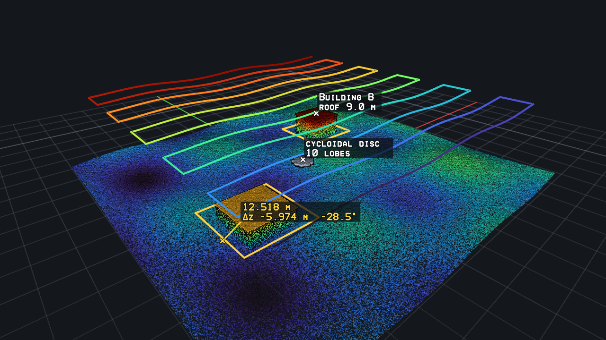
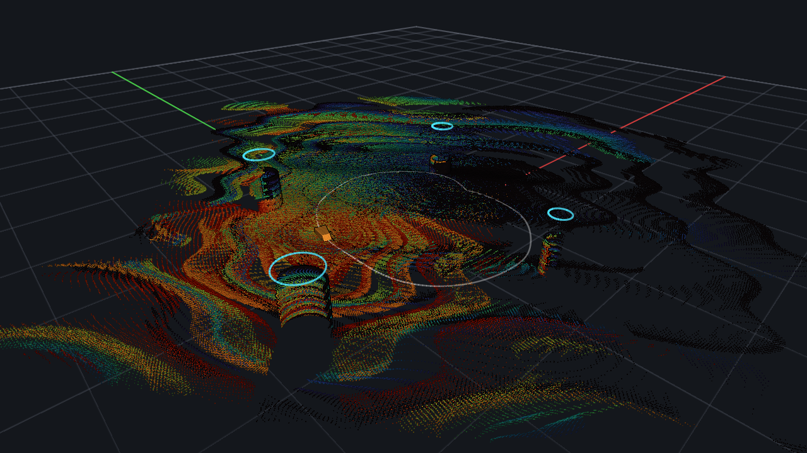
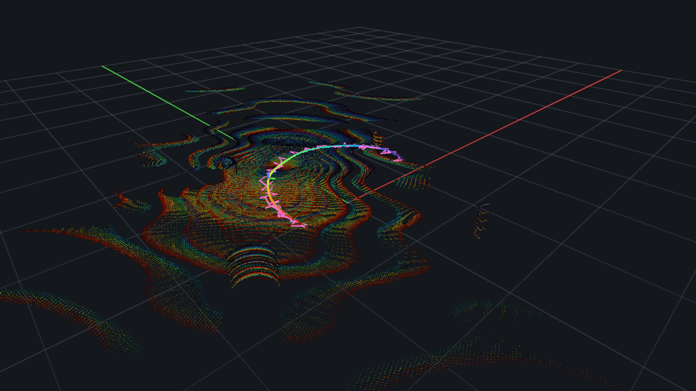

# SpatialRender.jl

[](https://github.com/rainerrodrigues/SpatialRender.jl/actions/workflows/ci.yml)
[](https://rainerrodrigues.github.io/SpatialRender.jl/dev/)
[](https://codecov.io/gh/rainerrodrigues/SpatialRender.jl)
[](https://github.com/JuliaTesting/Aqua.jl)

A native OpenGL renderer for **meshes, LiDAR point clouds, GIS vector layers and
trajectories in one scene**, for diagnostic views in robotics and aerial
systems. No browser, no plotting stack: GLFW + OpenGL 4.1 core, interleaved
vertex buffers uploaded straight from Julia arrays, and a GPU-free core
(ingestion, local frames, filters, BVH / k-d tree, culling, picking, camera)
that runs and tests headless.





*`examples/demo.jl` (top): a cycloidal-drive disc (CAD), 480k LiDAR points after
outlier removal, GIS parcels reprojected from lon/lat into ENU, and a UAV
survey trajectory colored by time. `examples/live.jl` (bottom): a rover streaming a simulated LiDAR, points colored by scan age.*

The [documentation](https://rainerrodrigues.github.io/SpatialRender.jl/dev/) has step-by-step
tutorials ([getting started](https://rainerrodrigues.github.io/SpatialRender.jl/dev/tutorials/getting_started/),
[point clouds](https://rainerrodrigues.github.io/SpatialRender.jl/dev/tutorials/point_clouds/),
[maps and frames](https://rainerrodrigues.github.io/SpatialRender.jl/dev/tutorials/maps_and_frames/),
[live robot data](https://rainerrodrigues.github.io/SpatialRender.jl/dev/tutorials/live_robot/),
[replaying ROS 2 bags](https://rainerrodrigues.github.io/SpatialRender.jl/dev/tutorials/replay_bags/)),
a guide per topic and the full API reference. The tutorials' code runs on every
documentation build, and their images are its output.

## Quick start

```julia
using SpatialRender

scene = Scene()
load!(scene, "scan.las")              # first georeferenced file sets the local frame
load!(scene, "boundaries.geojson")    # reprojected into the same frame
add!(scene, load_stl("bracket.stl"; scale = 1e-3))   # mm CAD → m
open_viewer(scene)
```

```bash
julia -t auto --project=. examples/demo.jl            # interactive
julia -t auto --project=. examples/demo.jl shot.png   # offscreen screenshot
julia -t auto --project=. examples/live.jl            # rover + streaming LiDAR
julia -t auto --project=. examples/octree.jl big.las  # out-of-core survey
julia -t auto --project=. examples/replay.jl my_bag/  # replay a ROS 2 bag (no argument: demo bag)
```

## What is in the box

| Stage | Implementation |
|---|---|
| **Ingestion** | Binary/ASCII STL, OBJ (native); LAS 1.0–1.4, point formats 0–10, via `Mmap` with threaded decoding (5M points ≈ 0.06 s); LAZ through `laszip` from LAStools_jll (installed automatically); GeoJSON; trajectories from positions or lon/lat/alt |
| **Local frames** | `ENUFrame(lat, lon, h)` (WGS84 → ECEF → ENU in Float64), `OffsetFrame` for UTM/projected data. GPU data is Float32 offsets near the origin, so no precision loss |
| **Preprocessing** | Statistical and radius outlier removal, voxel downsampling, RANSAC ground plane (remove / keep / classify), crop box, composable with `\|>`; `AttributeOutlierFilter` (z-score, IQR, MAD, Hampel) via the KaosCleaner engine |
| **Indexing** | Binned-SAH BVH for meshes (allocation-free ray casts). Point clouds are reordered in place into contiguous k-d tree chunks, which also answer k-NN and radius queries, so the index costs one entry per chunk rather than per point |
| **Culling + LOD** | Frustum culling of chunks into two pre-allocated `Int32` arrays (`first`, `count`) that feed `glMultiDrawArrays` directly. Points are shuffled inside each chunk, so drawing a shorter prefix gives a uniform subsample. Culling 5M points takes ~8 µs per frame and allocates nothing |
| **GPU** | Interleaved `PointVertex` (20 B: position, RGBA, 16-bit intensity, class, flags; no padding), `MeshVertex` (32 B: position, normal, uv), per-instance `LineVertex`. These isbits layouts go to `glBufferData` without repacking, with every attribute 4-byte aligned |
| **Shaders** | Points: pixel- or world-sized round splats colored by height / intensity / ASPRS class / RGB (Turbo map). Meshes: Blinn-Phong headlight, hemisphere ambient, two-sided, wireframe overlay. Lines: screen-space, anti-aliased, near-plane clipped instanced ribbons |
| **Shader tooling** | Programs cached per context by source hash; `validate_shaders()` checks every stage with `glslangValidator` from glslang_jll (CI, no GPU) or the live driver |
| **Camera** | Quaternion camera, turntable orbit (pitch-clamped), pan, zoom, fly mode, frame-all, top view, ortho toggle, pick-to-pivot |
| **Poses** | Every layer has a pose (`set_pose!(layer, position, Quat)` or a 4×4 matrix). Moving a layer is one uniform update; culling, LOD and picking run in the layer's own frame |
| **Live data** | `StreamingPointCloud` ring buffer: `push_scan!(layer, points; pose)` from any thread or task. Only dirty ranges are uploaded (`glBufferSubData`), nothing is re-indexed, and memory stays bounded. Optional coloring by scan age |
| **Out-of-core** | `build_octree(las, dir)` converts in streaming passes; peak RAM is one bucket (~4M points by default), not the survey. Nodes split only along long axes, so flat surveys become quadtrees. `OctreeCloud` streams nodes by screen size within a point budget, on a background thread, with LRU eviction. Point sizes adapt per node octant, so coarse areas still read as continuous surfaces |
| **Bag replay** | Native MCAP / rosbag2 reader, ROS 2 message decoding, TF frame tree, timeline player with seek and speed control, status overlay |
| **Eye-dome lighting** | Screen-space log-depth shading on points and meshes (`B` toggles it) |
| **Annotations** | Labels (`annotate!`) and measurements (`measure!`: distance, Δz, slope) in an original stroke font, so no font files are needed; measure mode in the viewer |
| **Output** | Interactive window; `snapshot` (shown inline in notebooks), `render_offscreen` / `screenshot` to PNG (zlib from Julia's own `Zlib_jll`) for CI and reports |

## Viewer controls

| Input | Orbit mode | Fly mode |
|---|---|---|
| left drag | orbit about the pivot | look |
| right / middle / shift-left drag | pan | pan |
| scroll | zoom | fly speed |
| W A S D, Q E (shift = 4×) | — | move, down / up |
| double-click | pick: set the pivot and log the point in local + source coordinates | same |

`Tab` switches orbit ↔ fly · `F` frame all · `T` top view · `O` ortho ·
`1`–`5` color by height / intensity / class / RGB / scan age · `+`/`-` point size ·
`P` pixel ↔ world point size · `L` LOD on/off · `M` wireframe · `G` grid ·
`B` eye-dome lighting · `R` measure mode (click two points; `Backspace` undoes) ·
`I` status overlay · `F12` screenshot · `H` help · `Esc` close.

Bag replay: `Space` play / pause · `←` `→` seek 1 s (shift: 10 s) · `[` `]`
half / double speed · `Home` restart.

`render_offscreen` and `screenshot` need no window, and work even on a machine
without a display (a server, CI): GLFW falls back to its null platform. Set
`JULIA_GLFW_PLATFORM=null` there to silence GLFW's warnings.

Pass `block = false` to get the `Viewer` back and drive it yourself
(`step!(viewer)`), for example from a robot's update loop. Layers added to the
scene while it is open are uploaded on the next frame.

## Live data and poses

```julia
scene = Scene()
rover = add!(scene, load_stl("rover.stl"))
lidar = add!(scene, StreamingPointCloud(2_000_000; max_age = 100))   # newest 2M points
v = open_viewer(scene; block = false)

Threads.@spawn for msg in sensor_feed           # any thread: updates are locked
    set_pose!(rover, msg.position, msg.orientation)
    push_scan!(lidar, msg.points; pose = (msg.sensor_position, msg.orientation))
end
run!(v)
```

`examples/live.jl` simulates this with a ray-cast 16-beam LiDAR at 10 Hz.
Use `touch!(layer)` after editing a layer's vertices in place.

## Replaying ROS 2 bags

```julia
replay("flight_2026_11_20/")          # rosbag2 directory or .mcap file; opens a viewer and plays
```

Or, step by step:

```julia
p = open_bag("drive.mcap"; history = 4.0)   # seconds of scans kept on screen
p.bag                                       # topics, types, message counts
seek!(p, 12.5); play!(p)
open_viewer(p.scene; player = p)
```



*`examples/replay.jl`: a recorded rover bag at t = 12 s. LiDAR scans are placed
through the TF chain map → odom → base_link → lidar at their own timestamps.
The odometry trail is colored by time, the GNSS fixes (pink) are anchored to
it, and the green line is the current plan.*

A native MCAP reader handles uncompressed, zstd and lz4 chunks and needs no
ROS installation. Each topic type is drawn like this:

| Topic type | Drawn as |
|---|---|
| `tf2_msgs/TFMessage` (`/tf`, `/tf_static`) | the frame tree, interpolated (slerp) at each message's stamp |
| `sensor_msgs/PointCloud2` | streaming cloud colored by scan age. Reads float32/float64 xyz, any-type intensity, packed RGB; `ring` becomes the class |
| `nav_msgs/Odometry`, `geometry_msgs/PoseStamped` | trajectory colored by time, plus an axes marker at the interpolated current pose |
| `nav_msgs/Path` | the latest plan at the current time |
| `sensor_msgs/NavSatFix` | ENU track whose first fix is anchored at the robot's pose |

The fixed frame is `map`, `world` or `odom` (whichever exists), else the
root of the TF tree; `fixed_frame =` overrides it.

Real recordings are often incomplete, and the player is built for that:

- **Sensor frames missing from TF** (typically when `/tf_static` was published
  before recording started) are drawn at the robot's base frame, with a
  warning. Give the real mountings with
  `open_bag(bag; static_transforms = [StampedTransform(0, "base_link", "lidar_front", Vec3d(1.2, 0, 1.8), Quat())])`,
  or choose `missing_frames = :origin` / `:skip`.
- **Recording gaps** break trails instead of drawing straight jumps, and TF is
  only interpolated across gaps up to `max_tf_gap` seconds (default 2).
- **Sparse or throttled LiDAR topics:** `history = :auto` keeps enough scans
  on screen for the sparsest one.
- **Data recorded in bursts:** with `skip_gaps = true` (default) playback jumps
  over stretches with no messages. `MCAPWriter` and the
`encode_*` functions write bags from Julia: `examples/replay.jl` records its
demo bag this way.

## Large surveys

```julia
build_octree("county.las", "county_octree")    # once; streams the file, bounded RAM
scene = Scene()
load!(scene, "county_octree"; point_budget = 4_000_000)
open_viewer(scene)
```

A 3M-point file converts in about 5 s. Coarse octree levels add about 10%
storage over the raw points.

## Point cloud cleanup

```julia
pc, frame = load_las("flight.las"; gps_time = true)
clean = pc |> (GroundPlaneFilter(mode = :classify) |>
               StatisticalOutlierFilter(k = 8, nsigma = 2.0) |>
               VoxelDownsample(0.05))

using KaosCleaner                                      # enables the extension
clean = AttributeOutlierFilter(attributes = [:intensity], method = "hampel")(clean)
```

## Memory

Measured on a 3M-point LAS file:

| Stage | Memory |
|---|---|
| point in RAM and on the GPU | 20 bytes |
| `load_las` (memory-mapped, threaded) | 20 B/pt, the vertices only |
| `build_point_index` | 4 B/pt while building; about 16 KB retained in total |
| statistical / radius outlier filter | ~53 / ~31 B/pt while running, nothing retained (1.7 s / 0.5 s for 3M points on 4 threads) |
| `voxel_downsample` | ~18 B/pt while running |
| `build_octree` | about 60 MB of working memory for 3M points beyond the memory-mapped input: the bucket buffers plus one decode chunk, so it is set by `bucket_points`, not the file size |
| octree at runtime | the memory-mapped node file plus the GPU-resident nodes (at most 2 × the point budget) |

Dependencies beyond Julia's standard library: GLFW and ModernGL (window and
OpenGL), StaticArrays, JSON3 (GeoJSON and octree index), and the small
`Zstd_jll` / `Lz4_jll` C libraries for compressed bags.

## Package extensions

| Load | Enables |
|---|---|
| `KaosCleaner` | `AttributeOutlierFilter` (per-attribute 1-D outlier statistics; Hampel windows follow GPS time) |
| `GeometryBasics` + `FileIO` (+ `MeshIO`) | `TriMesh(::GeometryBasics.Mesh)`; `load_mesh` falls back to FileIO for PLY, OFF, … |
| `GeoInterface` (e.g. via `GeoDataFrames`) | `gis_layer(df.geometry; frame = scene.frame)` for shapefiles, GeoPackage, any OGR source |

`GeometryBasics` also exports `Vec3f`; qualify it (`SpatialRender.Vec3f`)
when using both.

## GPU on WSL2

On WSL2, SpatialRender selects a hardware GPU before it opens its first
window. Mesa reaches Windows GPUs through its `d3d12` driver, but by default
it often falls back to the CPU. On hybrid laptops it also picks the
integrated GPU first, and if that GPU's WSL driver fails, Mesa gives up
instead of trying the discrete one. SpatialRender sets `GALLIUM_DRIVER=d3d12`
and tries `MESA_D3D12_DEFAULT_ADAPTER_NAME` = NVIDIA, AMD, Intel, then the
default. Each candidate is checked with a real context; if none works, the
original environment is restored and rendering stays on the CPU.
`configure_gpu!()` reports what was chosen.

- Your own `GALLIUM_DRIVER` is never overridden.
- `SPATIALRENDER_GPU_AUTOCONFIG=0` disables the selection.
- To give *every* OpenGL program in WSL the GPU, add these to `~/.profile`
  (adjust the adapter name to your GPU):

  ```bash
  export GALLIUM_DRIVER=d3d12
  export MESA_D3D12_DEFAULT_ADAPTER_NAME=NVIDIA
  ```

Measured on a GTX 1650 laptop (WSLg, 1280×720, eye-dome lighting on):

| Scene | GPU (D3D12) | CPU (llvmpipe) |
|---|---|---|
| 500k points, every point drawn | 5.1 ms (195 fps) | 58 ms |
| 5M points, every point drawn | 14.5 ms (69 fps) | 408 ms |
| 5M points, LOD | 7.2 ms (139 fps) | 79 ms |

All vertex attributes are kept 4-byte aligned. D3D12-backed drivers
otherwise convert vertex buffers on the CPU for every draw: an unaligned
1-byte attribute once made multi-range draws hang and lose the device.
A test guards the layouts.

## Tested against real-world data

Besides the unit tests, the readers were checked against public test data:

| Data | Source | Result |
|---|---|---|
| 416 MCAP files covering every combination of chunking, indexes, padding, repeated records and summary sections | Foxglove's MCAP conformance suite | all decode to the expected messages, channels and schemas |
| rosbag2 recordings, including split bags of 3 and 5 files | the rosbag2 project's test resources | message counts match each bag's `metadata.yaml` |
| 33 LAS files: versions 1.0–1.4, point formats 0–3, 6 and 7, extra bytes, many VLRs, deliberately broken files | PDAL's test data | identical to LasIO.jl on every point where LasIO can read the file (positions within 0.12 mm); the header bounds agree elsewhere |
| ASCII and binary STL (the same parts in both encodings), OBJ with normals and UVs | three.js examples | both encodings give identical triangles |
| 20 GeoJSON files with nulls, BOMs, collections and invalid JSON | GDAL's test data | geometry counts match an independent count |
| A 25-minute, 1.3 GB recording from an autonomous shuttle bus: 9 LiDAR topics (Velodyne VLP-16, localisation and safety scanners), 4 odometry sources, GNSS and TF | [nUWAy2](https://huggingface.co/datasets/xrkong/nuway_rosbag) (MIT) | all 70 topic counts match `metadata.yaml`; every point cloud decodes in four real field layouts; scans placed via TF register scan to scan (no convention error: the inverse transform fits 9× worse) |
| 60 s of a handheld forest walk: Ouster OS0-64 at 20 Hz, `/tf` map → body for every scan, `/tf_static` mountings including the Ouster's 180° sensor → lidar yaw | [Forest walks 2026-08-12](https://doi.org/10.5281/zenodo.24378954) (CC BY 4.0) | all 13 published static transforms reproduced (≤ 5e-14); `/tf` poses match the published trajectory to 1 µm; scans placed through the full TF chain lie on the dataset's registered map with a median of 4.3 cm, 99.6 % within 10 cm (the map's 0.1 m voxels limit this). Without `/tf_static`: 20 cm, 30 %. Reproduce with `benchmark/realdata_tf_alignment.jl` |

The shuttle recording showed what real logs look like: `/tf_static` not
recorded (sensor frames missing from TF), odometry in an unconnected `odom`
frame, recording gaps of several minutes, heavily throttled LiDAR topics and
data captured in bursts. The player handles each of these (see the replay
section); the fixes are listed in the CHANGELOG.

## Limits

- **STEP / IGES** are B-rep CAD, not meshes; tessellate them to STL/OBJ first
  (FreeCAD or OpenCASCADE). `load_mesh` says so instead of failing obscurely.
- **Projected GIS layers** need an `OffsetFrame`, or reprojection to EPSG:4326
  for an `ENUFrame`. There is no PROJ dependency.
- Bag replay decodes ROS 2 (CDR) messages only. ROS 1 messages inside MCAP
  are skipped, and rosbag2 SQLite (`.db3`) bags need
  `ros2 bag convert` to MCAP first. Big point clouds are decoded on the render
  thread, so very large scans at high rates can lower the frame rate during
  playback.
- The GNSS overlay assumes the fixed frame's x/y axes point east/north.
- The backend is OpenGL 4.1 core (the newest macOS supports), not WebGPU.
  Rendering is isolated in `src/render/`, so another backend can replace it
  without touching the core.

## Tests

```bash
julia --project=. -e 'using Pkg; Pkg.test()'
```

1077 tests covering:
- frames and every reader (round trips);
- filters;
- BVH against brute force, culling conservativeness and zero allocation;
- picking, including posed and scaled layers;
- the streaming ring buffer, including concurrent producers;
- the stroke font and annotations;
- octree invariants (no lost points, every point inside its node) and node
  selection;
- the MCAP container (all three compressions, many chunks) and every ROS 2
  message decoder, including a foreign PointCloud2 layout;
- TF lookups and interpolation, and bag playback (seek, history window, rate,
  loop, markers, plan, GNSS anchoring);
- the camera, the controller state machine, and PNG output.

The GPU tests (shader validation, offscreen rendering, EDL, poses, re-upload
on `touch!`, octree streaming) run when an OpenGL 4.1 context can be created
and are skipped otherwise. CI runs them under Xvfb with Mesa on Julia 1.10
and the current release.

## License

MIT. See [LICENSE](LICENSE).
