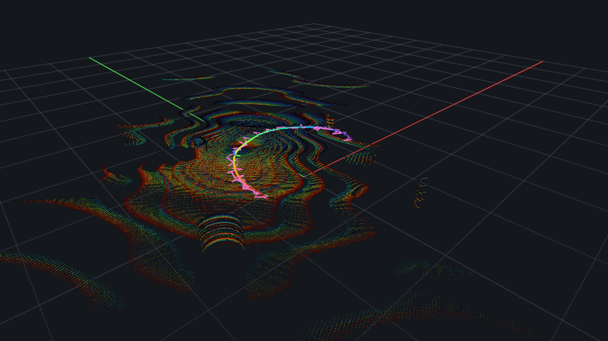

# Replaying ROS 2 bags

```julia
replay("flight_2026_11_20/")          # rosbag2 directory or .mcap file; opens a viewer and plays
```

Or, step by step:

```julia
p = open_bag("drive.mcap"; history = 4.0)   # seconds of scans kept on screen
p.bag                                       # topics, types, message counts
seek!(p, 12.5); play!(p)
open_viewer(p.scene; player = p)
```



*`examples/replay.jl`: a recorded rover bag at t = 12 s. LiDAR scans are placed
through the TF chain map → odom → base_link → lidar at their own timestamps.
The odometry trail is colored by time, the GNSS fixes (pink) are anchored to
it, and the green line is the current plan.*

A native MCAP reader handles uncompressed, zstd and lz4 chunks and needs no
ROS installation. Each topic type is drawn like this:

| Topic type | Drawn as |
|---|---|
| `tf2_msgs/TFMessage` (`/tf`, `/tf_static`) | the frame tree, interpolated (slerp) at each message's stamp |
| `sensor_msgs/PointCloud2` | streaming cloud colored by scan age. Reads float32/float64 xyz, any-type intensity, packed RGB; `ring` becomes the class |
| `nav_msgs/Odometry`, `geometry_msgs/PoseStamped` | trajectory colored by time, plus an axes marker at the interpolated current pose |
| `nav_msgs/Path` | the latest plan at the current time |
| `sensor_msgs/NavSatFix` | ENU track whose first fix is anchored at the robot's pose |

The fixed frame is `map`, `world` or `odom` (whichever exists), else the
root of the TF tree; `fixed_frame =` overrides it.

Real recordings are often incomplete, and the player is built for that:

- **Sensor frames missing from TF** (typically when `/tf_static` was published
  before recording started) are drawn at the robot's base frame, with a
  warning. Give the real mountings with
  `open_bag(bag; static_transforms = [StampedTransform(0, "base_link", "lidar_front", Vec3d(1.2, 0, 1.8), Quat())])`,
  or choose `missing_frames = :origin` / `:skip`.
- **Recording gaps** break trails instead of drawing straight jumps, and TF is
  only interpolated across gaps up to `max_tf_gap` seconds (default 2).
- **Sparse or throttled LiDAR topics:** `history = :auto` keeps enough scans
  on screen for the sparsest one.
- **Data recorded in bursts:** with `skip_gaps = true` (default) playback jumps
  over stretches with no messages. `MCAPWriter` and the
`encode_*` functions write bags from Julia: `examples/replay.jl` records its
demo bag this way.

```@docs; canonical=false
replay
open_bag
seek!
tick!
open_mcap
MCAPWriter
FrameTree
lookup_transform
decode_pointcloud2
```
