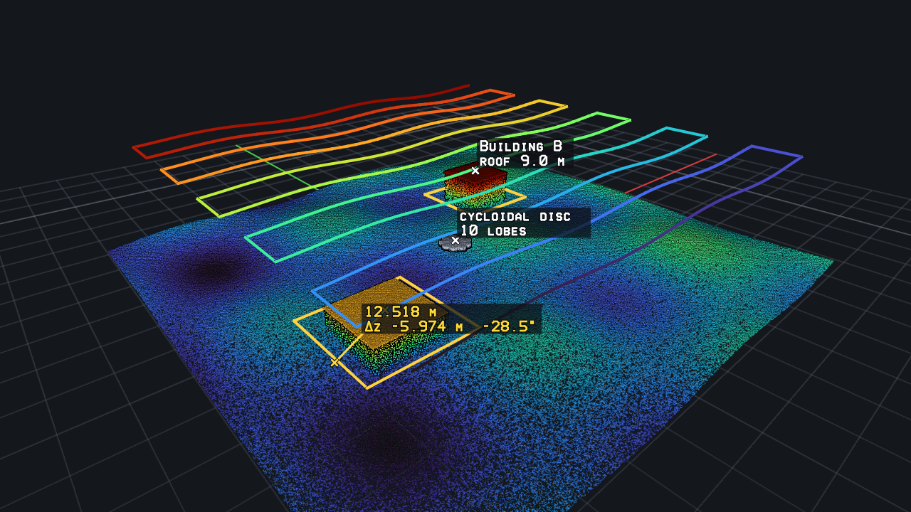
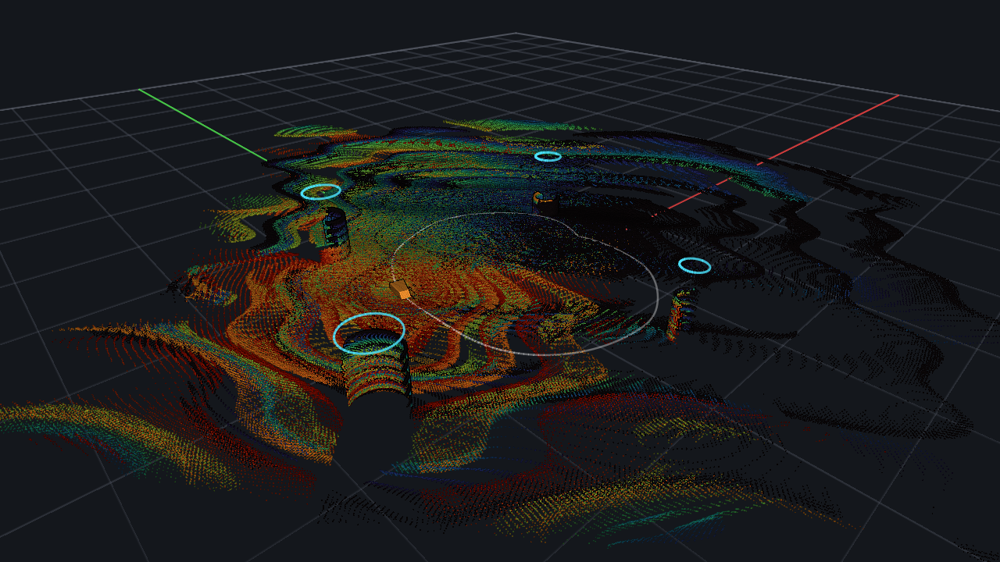

# SpatialRender.jl


A native OpenGL renderer for **meshes, LiDAR point clouds, GIS vector layers and
trajectories in one scene**, for diagnostic views in robotics and aerial
systems. No browser, no plotting stack: GLFW + OpenGL 4.1 core, interleaved
vertex buffers uploaded straight from Julia arrays, and a GPU-free core
(ingestion, local frames, filters, BVH / k-d tree, culling, picking, camera)
that runs and tests headless.





*`examples/demo.jl` (top): a cycloidal-drive disc (CAD), 480k LiDAR points after
outlier removal, GIS parcels reprojected from lon/lat into ENU, and a UAV
survey trajectory colored by time. `examples/live.jl` (bottom): a rover streaming a simulated LiDAR, points colored by scan age.*

## Installation

```julia
using Pkg
Pkg.add(url = "https://github.com/rainerrodrigues/SpatialRender.jl")
```

## Quick start

```julia
using SpatialRender

scene = Scene()
load!(scene, "scan.las")              # first georeferenced file sets the local frame
load!(scene, "boundaries.geojson")    # reprojected into the same frame
add!(scene, load_stl("bracket.stl"; scale = 1e-3))   # mm CAD → m
open_viewer(scene)
```

```bash
julia -t auto --project=. examples/demo.jl            # interactive
julia -t auto --project=. examples/demo.jl shot.png   # offscreen screenshot
julia -t auto --project=. examples/live.jl            # rover + streaming LiDAR
julia -t auto --project=. examples/octree.jl big.las  # out-of-core survey
julia -t auto --project=. examples/replay.jl my_bag/  # replay a ROS 2 bag (no argument: demo bag)
```

## What is in the box

| Stage | Implementation |
|---|---|
| **Ingestion** | Binary/ASCII STL, OBJ (native); LAS 1.0–1.4, point formats 0–10, via `Mmap` with threaded decoding (5M points ≈ 0.06 s); LAZ through the `laszip`/`pdal` CLI; GeoJSON; trajectories from positions or lon/lat/alt |
| **Local frames** | `ENUFrame(lat, lon, h)` (WGS84 → ECEF → ENU in Float64), `OffsetFrame` for UTM/projected data. GPU data is Float32 offsets near the origin, so no precision loss |
| **Preprocessing** | Statistical and radius outlier removal, voxel downsampling, RANSAC ground plane (remove / keep / classify), crop box, composable with `\|>`; `AttributeOutlierFilter` (z-score, IQR, MAD, Hampel) via the KaosCleaner engine |
| **Indexing** | Binned-SAH BVH for meshes (allocation-free ray casts). Point clouds are reordered in place into contiguous k-d tree chunks, which also answer k-NN and radius queries, so the index costs one entry per chunk rather than per point |
| **Culling + LOD** | Frustum culling of chunks into two pre-allocated `Int32` arrays (`first`, `count`) that feed `glMultiDrawArrays` directly. Points are shuffled inside each chunk, so drawing a shorter prefix gives a uniform subsample. Culling 5M points takes ~8 µs per frame and allocates nothing |
| **GPU** | Interleaved `PointVertex` (20 B: position, RGBA, 16-bit intensity, class, flags; no padding), `MeshVertex` (32 B: position, normal, uv), per-instance `LineVertex`. These isbits layouts go to `glBufferData` without repacking, with every attribute 4-byte aligned |
| **Shaders** | Points: pixel- or world-sized round splats colored by height / intensity / ASPRS class / RGB (Turbo map). Meshes: Blinn-Phong headlight, hemisphere ambient, two-sided, wireframe overlay. Lines: screen-space, anti-aliased, near-plane clipped instanced ribbons |
| **Shader tooling** | Programs cached per context by source hash; `validate_shaders()` checks every stage with `glslangValidator` (CI, no GPU) or the live driver |
| **Camera** | Quaternion camera, turntable orbit (pitch-clamped), pan, zoom, fly mode, frame-all, top view, ortho toggle, pick-to-pivot |
| **Poses** | Every layer has a pose (`set_pose!(layer, position, Quat)` or a 4×4 matrix). Moving a layer is one uniform update; culling, LOD and picking run in the layer's own frame |
| **Live data** | `StreamingPointCloud` ring buffer: `push_scan!(layer, points; pose)` from any thread or task. Only dirty ranges are uploaded (`glBufferSubData`), nothing is re-indexed, and memory stays bounded. Optional coloring by scan age |
| **Out-of-core** | `build_octree(las, dir)` converts in streaming passes; peak RAM is one bucket (~4M points by default), not the survey. Nodes split only along long axes, so flat surveys become quadtrees. `OctreeCloud` streams nodes by screen size within a point budget, on a background thread, with LRU eviction. Point sizes adapt per node octant, so coarse areas still read as continuous surfaces |
| **Bag replay** | Native MCAP / rosbag2 reader, ROS 2 message decoding, TF frame tree, timeline player with seek and speed control, status overlay |
| **Eye-dome lighting** | Screen-space log-depth shading on points and meshes (`B` toggles it) |
| **Annotations** | Labels (`annotate!`) and measurements (`measure!`: distance, Δz, slope) in an original stroke font, so no font files are needed; measure mode in the viewer |
| **Output** | Interactive window; `render_offscreen` / `screenshot` to PNG (zlib from Julia's own `Zlib_jll`) for CI and reports |

## Limits

- **STEP / IGES** are B-rep CAD, not meshes; tessellate them to STL/OBJ first
  (FreeCAD or OpenCASCADE). `load_mesh` says so instead of failing obscurely.
- **LAZ** needs `laszip` or `pdal` on `PATH`.
- **Projected GIS layers** need an `OffsetFrame`, or reprojection to EPSG:4326
  for an `ENUFrame`. There is no PROJ dependency.
- Bag replay decodes ROS 2 (CDR) messages only. ROS 1 messages inside MCAP
  are skipped, and rosbag2 SQLite (`.db3`) bags need
  `ros2 bag convert` to MCAP first. Big point clouds are decoded on the render
  thread, so very large scans at high rates can lower the frame rate during
  playback.
- The GNSS overlay assumes the fixed frame's x/y axes point east/north.
- The backend is OpenGL 4.1 core (the newest macOS supports), not WebGPU.
  Rendering is isolated in `src/render/`, so another backend can replace it
  without touching the core.
